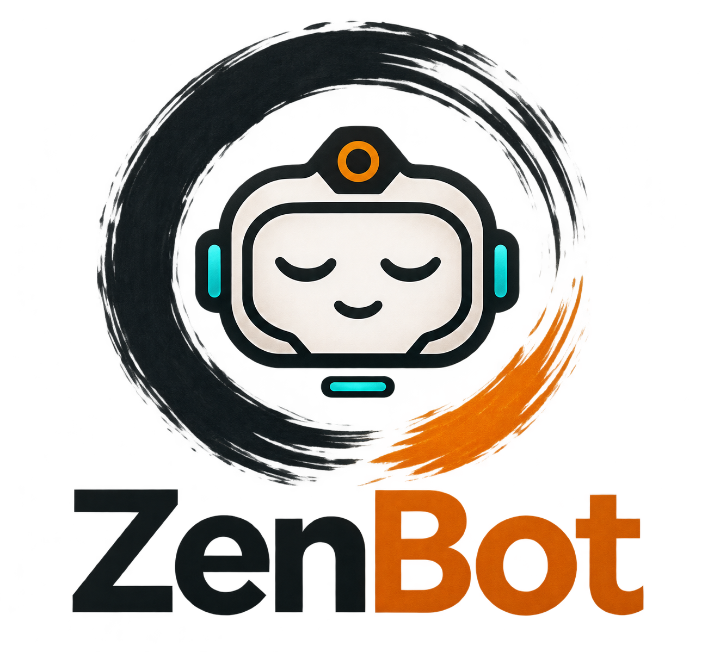
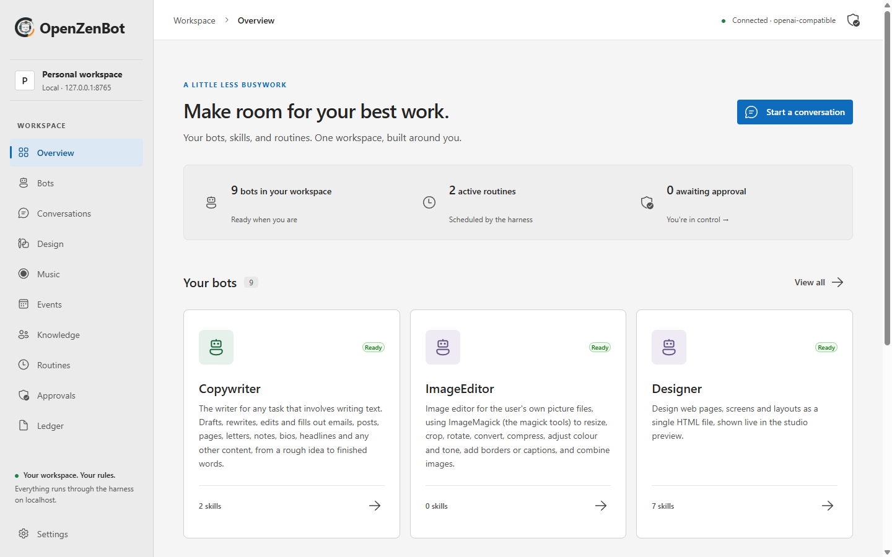
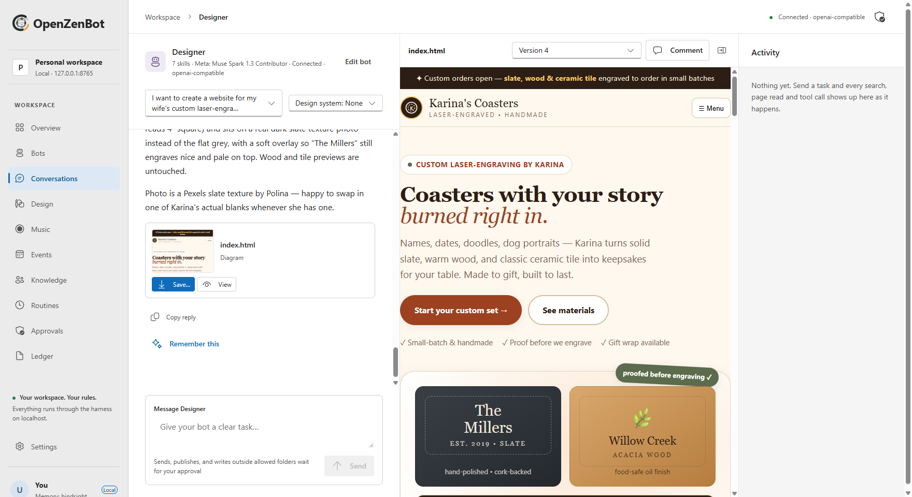
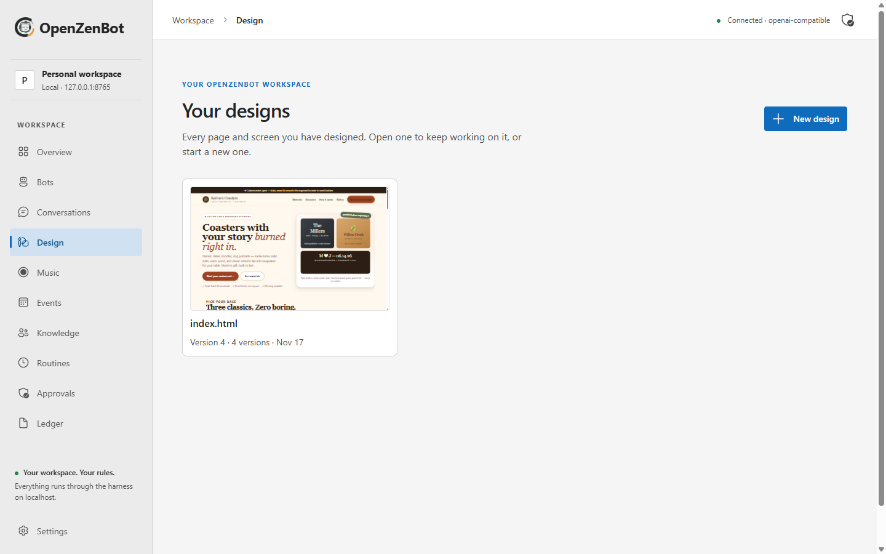
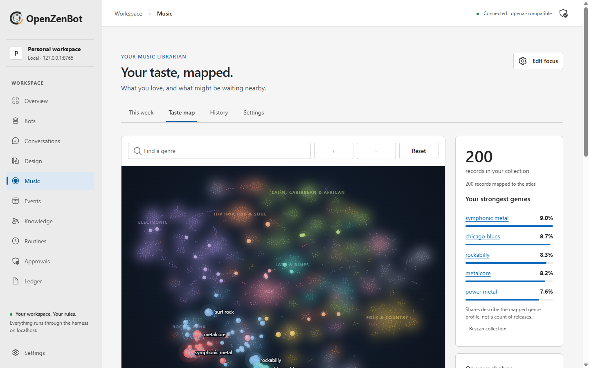
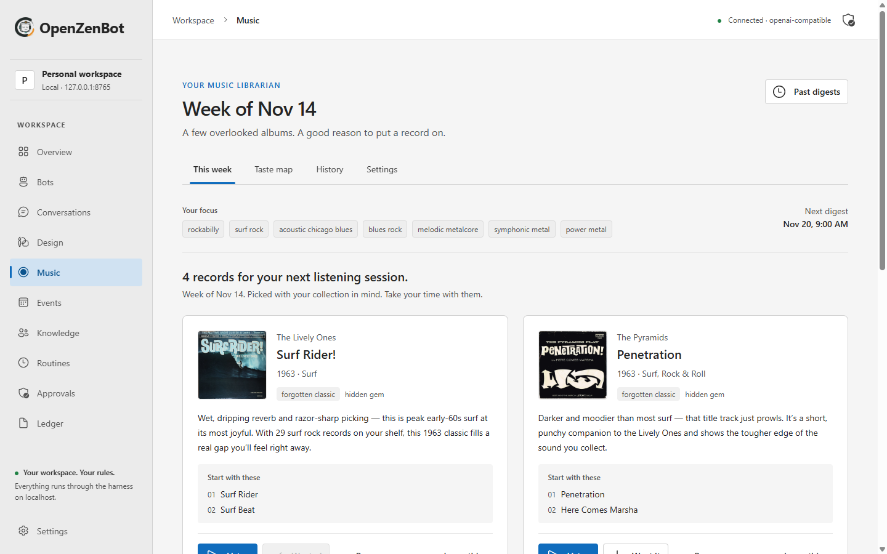
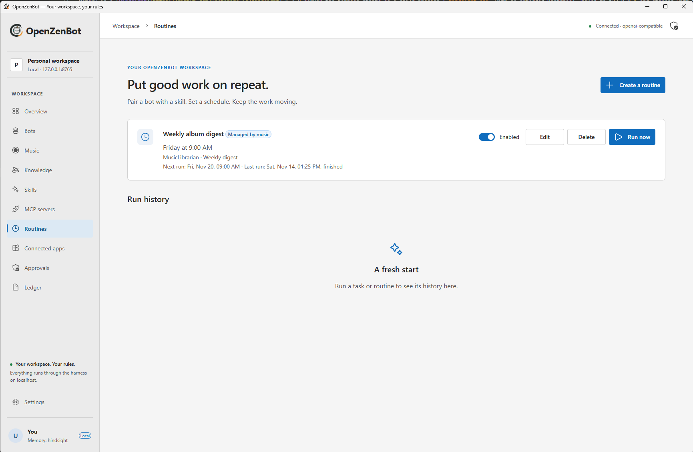
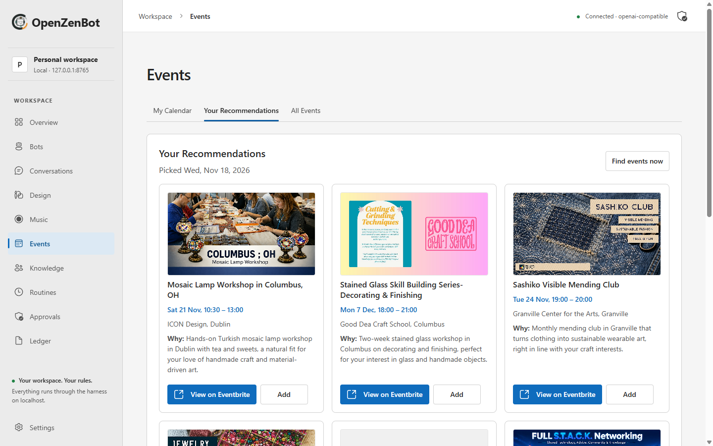
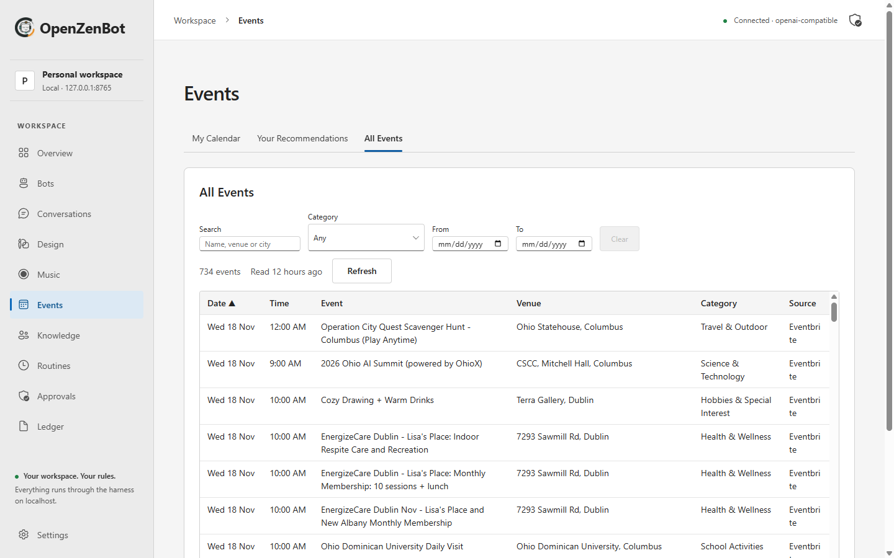
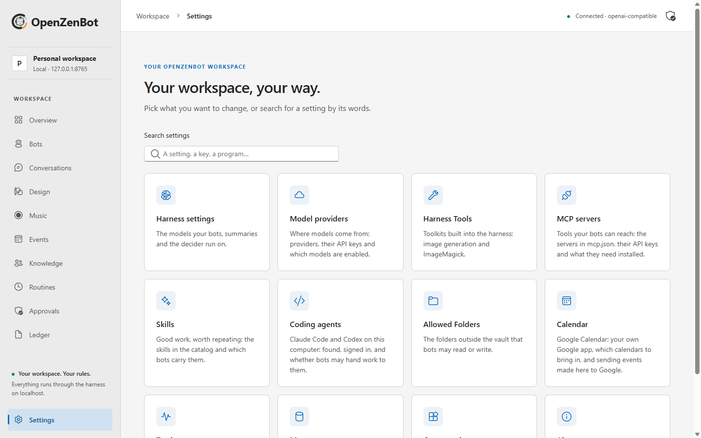

# open-zenbot

<p align="center">
  
</p>

An open-source AI workspace for your desktop: local-first, self-learning, and actually useful for daily life. Bring your own keys.

> **Just want to use it? [Download the installer (0.1.3 beta)](https://github.com/ServaboFidem/open-zenbot/releases/tag/v0.1.3)** for Windows or Ubuntu/Debian, then follow [Install](#install). No Python, Node.js or developer tools needed. To run it from the source code, see [Run from source](#run-from-source-development-builds).

> **Status: experimental.** open-zenbot is a passion project, not a product. Expect rough edges, breaking changes and features that are half-built. For more information, see the [wiki](https://github.com/ServaboFidem/open-zenbot/wiki). It is a work in progress: a few pages so far, with more on the way. Where it has no answer yet, this README, `AGENTS.md` and `.env.example` are the best guides.

Inspired by grokbot, open-zenbot is a team of bots that live on your machine. They work in a folder you can see, with tools you choose, and they know a little more each time you use them. It isn't a chat window over a model. Bots run commands, read and write documents, call MCP servers, hand work to each other in rooms, and run routines on a schedule, and every step lands in a ledger you can read.

The goal is three things at once:

- **Local-first.** The app, your data and your settings stay on your computer. A model can run there too.
- **Self-learning.** It remembers what you tell it and what it finds out, and uses that the next time.
- **Actually useful for daily life.** Not only for work: it finds records you'd like, events near you worth going to, and keeps your calendar.



## Why run it

- **Local-first: it's yours.** The harness and the desktop app run locally, bound to `127.0.0.1`. Your memory, files, conversations, calendar and settings live under `~/.zen-agents/` on your own disk. You pick the models and pay the provider directly, or nothing at all: alongside OpenRouter it runs on NVIDIA NIM, vLLM, LM Studio, Ollama or any OpenAI-compatible server (see [Models and providers](#models-and-providers)). One thing still needs the internet: the decider model runs on OpenRouter.
- **Self-learning: it remembers.** Memory is a [Hindsight](https://github.com/vectorize-io/hindsight) knowledge graph the harness runs for you. It learns from a short first-run interview, the files you import, the web pages bots read for you, and facts that come up while you work. A bot recalls only what bears on the task in front of it, and nothing moves into memory every bot can see until you confirm it. Work you repeat can be kept too: record a task in the browser once and it becomes a skill, and a skill plus a schedule is a routine.
- **Useful for daily life.** Each week a bot picks a few albums you don't own from what your record collection says you like (see [Music discovery](#music-discovery)), and another picks local events that fit your interests, which go on the built-in calendar when you say you're going (see [Events and calendar](#events-and-calendar)). Ask for a web page and the Designer builds it beside the chat while you point at what to change (see [Design studio](#design-studio)).
- **It does the work, not just the talking.** Bots come with a shell, the filesystem, Office and PDF skills, image tools, web search and whatever MCP servers you add. Ask ZenBot for something and it either answers itself or opens a room with the specialist bots that fit the job. A bot can also hand a coding job to Claude Code on your own subscription, in a folder it cannot leave (see [Coding agents](#coding-agents)).
- **You stay in charge.** Risky actions wait in Approvals: a shell command that writes outside your allowed folders, touches the harness's private folders, or brings a new person into memory. Bots can reach only the vault and the folders you grant them, as Full Access or Read-Only. Keys and settings sit beside the vault, where no bot can read them.

## Design philosophy

### Progressive disclosure

A model works best when its context holds only what the task needs. Every tool schema, skill manual and remembered fact it doesn't need costs tokens and pulls its attention away from the job. So open-zenbot discloses capability step by step, not all up front:

1. **The base prompt is small.** A bot starts with its identity and instructions from `bot-prompts/<id>.md` and nothing else.
2. **Each capability is a one-line catalog entry.** Every skill and MCP server has a short catalog entry: its name, a `use` line saying when it helps, what it needs, and what it must not do. The bot never sees the catalog. The decider reads it.
3. **The full body loads only when it's picked.** A skill's `SKILL.md` instructions and an MCP server's tool schemas reach the bot only when the router selects them for this task. A bot holding twenty skills might carry two into a given task.
4. **Memory works the same way.** Recalled facts and knowledge-graph sentences are scored against the task too, so a bot gets the handful that matter, not everything it has ever learned.

### How a bot gets its tools

Routing is a scoring job, not a writing job. Before each task, the router asks the decider one yes/no question per catalog entry: *would loading this help with this task?* The decider is a calibrated scoring model (`microsoft/microsoft-decision-1` on the OpenRouter Decisions API), so each entry gets a real probability rather than a model's guess written out in prose.

- **Skills compete.** Skills are kept in a band near the top score: every skill within 0.1 of the best, at most three. If even the best scores under 0.2, no skill loads and the bot works from its own instructions.
- **MCP servers cooperate.** One server finds a photo and another edits it, so a high score for one says nothing against the other. Each server that clears an absolute floor (0.5) loads, up to the same cap.
- **A bot's own servers always load.** The servers listed under `mcps` in a bot's file are part of who it is, so they aren't put to a vote.
- **Routing is cached and re-scored on change.** A route is reused until the task, the bot's catalog or the agreed scope changes. A terse follow-up like "do the rest" is routed together with the session's notes, so it still gets the tools the work needs.
- **It fails open, and says so.** If the decider is unreachable, every attached skill loads and the ledger records why, so a scoring outage never leaves a bot stranded without its tools.
- **New skills wait for you.** When you add a skill, the decider suggests which bot should hold it: first by role, then, to break a tie, by what each bot has actually done. Nothing attaches until you confirm.

### Keeping bots on track

- **The task is protected.** The task and its constraints sit in a pinned block that compaction never summarizes. When a long session is compacted, older turns fold into a summary, but the goal stays word for word.
- **Scope changes are confirmed.** When new text looks like a new goal or new constraints, the change waits for you before the pinned block is rewritten, and then every route is re-scored against the new scope.
- **A supervisor watches the loop.** Every few steps it asks the decider whether the run is progressing, repeating itself, or done. Then it lets the run continue, nudges the bot with a single note, or pauses the session until you resume it. It never kills your work.
- **Scoring and writing are separate.** The decider only scores fixed options and never writes prose. The generator writes summaries and compaction folds and never decides. Keeping the two apart makes every routing, recall and supervision choice a number you can inspect in the ledger.

## Install

For people who just want to use OpenZenBot. You do not need Python, Node.js or any developer tools.

1. Open the [0.1.3 beta release](https://github.com/ServaboFidem/open-zenbot/releases/tag/v0.1.3) and download the installer for your computer from its Assets list: the `.exe` for Windows, the `.deb` for Ubuntu or Debian. Later versions appear on the [Releases page](https://github.com/ServaboFidem/open-zenbot/releases).
2. **Windows:** run `OpenZenBot-Setup-<version>.exe`. The installer is not signed yet, so Windows SmartScreen warns about an unknown publisher: click "More info", then "Run anyway". **Ubuntu or Debian:** open a terminal in the download folder and run `sudo apt install ./OpenZenBot_<version>_amd64.deb`, then start OpenZenBot from your applications menu (or run `openzenbot`).
3. The first time you start it, OpenZenBot sets itself up. It needs a connection to the internet and about 5 GB of free disk space: it checks first and does not start with less (an update over an existing install needs about 1 GB). The Python environment takes about 2 GB of that on Linux, and roughly 2 GB more is fetched the first time the app starts (models and tool servers). This can take several minutes. You see each step as it happens. This happens once, and again after an update that changes what it needs.
4. It then asks for an [OpenRouter](https://openrouter.ai/) key. OpenZenBot needs an OpenRouter account for one thing: the decider model, which picks the right skills and tools for each task and checks shell commands before they run. Everything else can run on your own computer or through NVIDIA NIM: the models your bots talk with are your choice, in Settings. The key is kept in your OpenZenBot settings, not in the app.

Good to know:

- **Updates.** OpenZenBot checks the releases page about once a day and tells you when a newer version is out, with its release notes. Getting it means downloading the new installer and running it; nothing installs by itself. You can turn the check off or skip a version.
- **Where things are.** The downloaded parts live in the `runtime` folder of OpenZenBot's data folder: `~/.config/OpenZenBot/runtime` on Linux, `%APPDATA%\OpenZenBot\runtime` on Windows. Your chats, notes and bots are kept separately, under `~/.zen-agents`, and are never part of that folder.
- **Uninstall.** Windows: uninstall OpenZenBot from Settings > Apps; this also removes the `runtime` folder. Ubuntu or Debian: `sudo apt remove openzenbot`; delete `~/.config/OpenZenBot/runtime` yourself to get the disk space back. What the first start downloads stays too: memory models in `~/.cache/huggingface`, the memory database's Postgres in `~/.pg0` (your memories are in it), and tool servers in `~/.npm`; these folders are shared with other programs that use them, so check before deleting them. Neither touches `~/.zen-agents`. Delete that folder only if you want your chats and notes gone.
- **Not there yet.** There is no macOS app. ImageMagick, which a few tools use, is not installed by the app.

Maintainers: to cut a release, set the same new version in `package.json`, `pyproject.toml` and `packaging/harness/pyproject.toml`, run `uv lock --project packaging/harness`, commit, then tag `v<version>` and push the tag. The release workflow checks the tag and runs both test suites, builds both installers and opens a **draft** release with them attached. It is not public until a maintainer reads the notes and publishes the draft on GitHub.

## Run from source (development builds)

This section is for developers and contributors who want to run OpenZenBot from a clone of this repo, with the latest unreleased code. If you only want to use the app, use the installer instead: see [Install](#install).

You need [git](https://git-scm.com/), [uv](https://docs.astral.sh/uv/getting-started/installation/) and [Node.js](https://nodejs.org/) (with `npm`). Clone the repo, then from the repo root:

### Windows

```powershell
.\scripts\install-deps.ps1      # once: host tools the MCP servers need
.\scripts\dev.ps1               # start the harness and the app
```

### Linux

```sh
./scripts/install-deps.sh       # once: host tools the MCP servers need
./scripts/dev.sh                # start the harness and the app
```

**Ubuntu (23.10 and later): create an AppArmor profile for Electron once.** Ubuntu blocks unprivileged user namespaces (`kernel.apparmor_restrict_unprivileged_userns = 1`), which Chromium's sandbox needs. Without a profile, the app exits at start with `The SUID sandbox helper binary was found, but is not configured correctly` and the harness stops with it. The profile lets this one Electron binary use user namespaces, and it survives `npm install`:

```sh
./scripts/ubuntu-apparmor-profile.sh   # asks for sudo; --dry-run shows the profile, --remove deletes it
```

Run it from a real terminal (sudo asks for a password) after `npm install`. The profile names the Electron binary by its full path, so run it again if the repo moves. Making `node_modules/electron/dist/chrome-sandbox` root-owned with mode 4755 also works, but `npm install` resets it. Don't start Electron with `--no-sandbox`: the design pane runs bot-made pages. This is only for running from source: the `.deb` installer ships its own profile for the installed app.

`dev` runs `npm install` on the first start (when `node_modules` is missing), builds the GUI, starts the harness on `http://127.0.0.1:8765`, waits for it to answer and opens the app window. Closing the window stops the harness. Use `-Port 9000` (`--port 9000` on Linux) to move it to another port. `install-deps` takes `--dry-run` to show what it would do. A server whose tool is still missing shows "needs install" on the MCP servers page, with the fix and a Recheck button.

No key is needed to start. The harness starts unbound, and you add your OpenRouter key on the app's Settings page. To set anything else, copy `.env.example` to `.env` at the repo root. It lists every variable with its default. A variable already set in the shell wins over the file. Restart after editing `.env`.

### Memory (Hindsight)

Memory is a [Hindsight](https://github.com/vectorize-io/hindsight) 1.2.0 server the harness starts as a child process (`hindsight-api` with an embedded Postgres), bound to 127.0.0.1 and stopped with the harness.

- **Node and `npx` are needed for the memory dashboard** (the Knowledge page's graph view runs Hindsight's control plane through `npx`). Without them memory still works; the dashboard says Node's npx was not found.
- **The first start downloads models for two to four minutes.** The app opens with a loading overlay meanwhile. Later starts take about 35 s.
- **Upgrading from cognee starts memory fresh.** Facts kept by cognee do not move over; the people and organization lists do. Documents and pages you imported or learned before are imported again the next time you import or learn them. After the first successful start you can delete `<vault>/memory/cognee`.
- **Ports taken?** If 18888 (API), 5556 (Postgres) or 9999 (dashboard) is already in use, memory does not start and says which port (a taken dashboard port leaves only the dashboard unavailable). Set `ZEN_HINDSIGHT_PORT`, `ZEN_HINDSIGHT_PG_PORT` or `ZEN_HINDSIGHT_UI_PORT` to free ports. On a port other than 9999 the dashboard opens in your browser instead of inside the app.

Memory learns from the web through the `learn_page` tool and the `learn-company` skill: a bot hands over a page it fetched, and the harness keeps only what the page says about an organization, person, or product memory already knows (connected products, features, and places are written; new people and loose discoveries wait in Approvals; a page naming nothing known teaches nothing). The learn log and held discoveries live in `learn_log.json` and `learn_holds.json` under the vault.

## Models and providers

open-zenbot isn't tied to one model host. Add providers on Settings > Model providers. The add form has presets that fill in the address and whether a key is needed:

| Provider | Default address | Key |
| --- | --- | --- |
| OpenRouter | `https://openrouter.ai/api` | Yes |
| NVIDIA NIM (hosted) | `https://integrate.api.nvidia.com/v1` | Yes, free from [build.nvidia.com](https://build.nvidia.com) |
| vLLM | `http://localhost:8000/v1` | Only if you started it with `--api-key` |
| LM Studio | `http://localhost:1234/v1` | No |
| Ollama | `http://localhost:11434/v1` | No |

Any other server that speaks the OpenAI API (OpenAI, Groq, Together, DeepSeek, Mistral, llama.cpp and the rest) works too, through the same OpenAI-compatible adapter. Point a preset at another machine to use a GPU box on your network: an address on the local network or your Tailscale network counts as local. Models on local servers and on NVIDIA's hosted NIM show as **Free**.

The adapter handles the ways these servers differ from the OpenAI API. It reads the reasoning that vLLM and NIM return in `reasoning_content`, and it rewrites MCP tool names such as `files.read_file` into the strict form NIM requires (`files__read_file`), then maps them back when the model calls one.

Once a provider is added, choose a model for each job on Settings > Harness settings: **chat** for bots' work, **summary** for compaction and document summaries, and **decision** for the decider. Each bot can also run on its own model. For example, a coding bot can use a large hosted model while a note-taking bot uses a small one running in LM Studio. The decision model runs on OpenRouter's Decisions API by default, so the decider needs an OpenRouter key. Without one, the harness still runs, but it falls back to safe defaults: every attached skill loads, and every shell command that writes waits for your approval.

New in 0.1.3, and experimental: the decider can run on a local decision model instead. Enable the model on an OpenAI-compatible provider such as LM Studio; the capability test marks it when it can answer decisions (through chat, or through a server's own decision route), and it then appears in the Decision model picker. It has been tried by hand with a few small models on LM Studio only. With a local decision model every shell command still waits for your approval.

### Model fingerprinting

OpenRouter reports what each of its models can do. A plain OpenAI-compatible server lists only model ids. Model names can't be trusted ("embed" in an id proves nothing), so when you enable a model on such a server, the harness tests it directly and records what it actually does:

| Test | What it sends | What counts as a pass |
| --- | --- | --- |
| Chat | "Reply with the word ok." | A reply. Thinking in the answer (`reasoning_content` or `<think>`) marks the model as one that reasons |
| Embeddings | An embeddings request | A vector back (NIM's asymmetric models are retried with an `input_type`) |
| Tools | A `get_weather` tool and a question that needs it (asked again with `tool_choice: required` for servers like LM Studio and llama.cpp that refuse a named tool choice) | An actual call to `get_weather`, not just an accepted request |
| Structured output | A strict JSON schema for a colour | Valid JSON matching the schema |
| Image input | A one-pixel red image: "What colour is this?" | An answer |

Many servers accept `tools` or `response_format` and then quietly ignore it, so each test checks what came back, not whether the request was accepted. A reasoning model gets a larger token budget for the later tests, so its thinking doesn't crowd out the answer. A model's kind (text, embedding) comes from which tests it passes. A model the key can't run is hidden. If the server is rate-limited, times out or is down, the model isn't enabled at all, because half a fingerprint would mislead the harness about what the model can do.

The results decide where a model can be used. Each job's picker offers only models of the right kind, and the model lists tag each one with **Vision**, **JSON**, **Tools**, reasoning and cost, so you can see at a glance which local model can drive a bot that calls tools and which is only fit for summaries.

## Design studio

Describe a web page, an app screen or a layout, and the Designer bot builds it while you watch. Open the Design page and choose New design, or just ask ZenBot: when a request is design work, it opens the Designer for you.

- **A live preview beside the chat.** The design shows in a pane docked next to the conversation and updates each time the bot finishes a revision.
- **Point and comment.** Click any element in the preview and write a note about it ("make this heading smaller", "swap these two cards"). Your comments go to the bot with your next message, up to 20 at a time, so you never have to describe where something is.
- **Questions as a form.** When the bot needs to know something before it starts (the audience, the tone, the sections you want), it asks in a short form you fill in, not a wall of text.
- **Design systems.** Pick a design system for a conversation and every design there follows its look: colors, type, spacing. Two ship with the app. To add your own, make a folder in `~/.zen-agents/vault/design-systems/` with a `DESIGN.md` describing the look and, if you like, a `tokens.css`.
- **Every version is kept.** Each revision is saved as a numbered copy, so version 1 is still there after version 5.
- **One file you own.** A design is a single HTML file with everything inside it, saved under `~/.zen-agents/vault/designs/`. It opens in any browser, works offline and needs nothing else to go with it.
- **All your designs in one place.** The Design page shows a card for each design; click one to go back to its conversation.





The preview is locked down: a bot-made page runs in a sandbox with no access to the network, so nothing in it can load from or send to anywhere.

## Music discovery

Music is off until you turn it on. Open Music > Settings, switch it on and enter your Discogs username. A scan then reads your public collection and the Taste map shows your genres; the username is all it needs.



The weekly digest also needs a Discogs personal access token (Discogs > Settings > Developers > Generate new token), pasted in the same place. It is saved to `vault-settings/music_keys.json`, owner-only, never to `.env` or the repo. With the token, the Weekly album digest routine (Routines page, or Run now) has the music-librarian bot pick albums you do not own, have not been shown and have not wanted, and each card links to YouTube Music and can be added to your Discogs wantlist. By default it runs on Fridays at 09:00 and picks 4 albums; change the day, time and count in Music > Settings. Without it you still get the Taste map, but no digest and no wantlist.



The digest is an ordinary routine, so it sits on the Routines page beside any you create, where you can switch it off, edit it or run it now.



Music data (database, genre atlas, covers) lives in `~/.zen-agents/vault-music/`, beside the vault and out of bots' reach. The atlas is the [Soundlore](https://github.com/aydearcas/Soundlore) genre data, downloaded on first use from a pinned commit and checked against a hash. Most of it is CC0, but the artist-genre links come from MusicBrainz genre votes and are CC BY-NC-SA 3.0, so this feature is for non-commercial use (see [Credits](#data)).

## Events and calendar

The Events page has three tabs: My Calendar, Your Recommendations and All Events. It is new in 0.1.1.

**Your Recommendations.** Event discovery is off until you turn it on. Open Settings > Calendar > Event discovery, switch it on and paste the address of your city's Eventbrite page (for example `https://www.eventbrite.com/d/oh--columbus/events/`), then tick the categories you care about and write a line about your interests. The harness reads that city's public Eventbrite listings for this month and next. Each week the event scout bot picks six to eight of them and says why each one fits you. "Find events now" runs it on the spot. A card links to the event's own page; when you come back and say you signed up, or press Add, the event goes on your calendar.



**All Events.** Everything the last read found, as a list you can search, filter by category and date, and sort. Open a row for the details and add it to your calendar from there.



**My Calendar.** A calendar the harness keeps on your computer. It works with no account. You can also connect Google Calendar: you make your own Google app (the steps are on Settings > Calendar) and sign in, and your Google calendars are read into the page. Sending events made here back to Google is a separate switch, off by default, and asks for write access only when you turn it on.

Like the music digest, the weekly events digest is a routine (Thursdays at 09:00 by default), so it sits on the Routines page. The scout reads listings written by strangers, so it is a closed bot: it has no shell, no browser and no file tools, only the three tools that list events and save its picks.

Good to know:

- **This part is the least tested.** Reading Eventbrite, the scout and reading from Google have each run for real, on one computer. Sending events to Google has only run against a test stand-in. A second source, FindLocal (optional, needs your own key), has never been run against the real service.
- **Eventbrite is read from its public pages**, one request a second, at most 40 pages a refresh, at most twice a day. That is for personal use; Eventbrite's terms on automated access were not checked.
- **Where it lives.** Calendar and event data are in `~/.zen-agents/vault-calendar/`, beside the vault and outside the folders bots' file tools can reach.

### Facebook browser helper

A small Chrome extension in `src/helper/` lets the Events page show your Facebook events. It reads three Facebook pages while you have them open in Chrome: your events (`facebook.com/events/`), your invites (`facebook.com/events/invites/`) and birthdays (`facebook.com/events/birthdays/`). It sends what it read to the harness on this computer, and the Facebook tab on the Events page shows it: invites, events waiting for your approval, and birthdays. Nothing goes on your calendar until you approve it.

It only watches. It never clicks, answers an invite, posts or sends a message, and it never opens, reloads or moves a tab. It sends data only to `http://127.0.0.1:8765`, the harness on your own computer. It never reads your News Feed or any other Facebook page. It uses the Facebook sign-in you already have in that Chrome, and it asks for no password.

**Load it in Chrome** (or Edge, Brave or another Chromium browser):

1. Start the harness (the desktop app, or `uv run python -m src.harness.main`), so it answers on port 8765.
2. Open `chrome://extensions` and switch on **Developer mode** (top right).
3. Click **Load unpacked** and choose the `src/helper` folder of this repo (the folder that holds `manifest.json`). **OpenZenBot Facebook Helper** appears with the ZenBot icon.
4. Sign in to Facebook in that Chrome if you are not already, and open `https://www.facebook.com/events/`. Open the invites and birthdays pages too if you want those.
5. Within about 30 seconds the Facebook tab on OpenZenBot's Events page shows what it read. After that it reads those tabs again every four hours while they stay open.

Chrome asks for access to Facebook's events and birthdays pages. The helper needs this to start reading when you click through to Events inside Facebook, where the page changes without a reload. After `git pull` brings a new version of the helper, click the reload arrow on its card in `chrome://extensions`. Any events or birthdays tabs you already have open are read again, with no need to reload them.

Good to know:

- **English only.** It reads the dates Facebook writes in English ("Tomorrow at 10 AM", "Sat, Nov 28"). On a Facebook set to another language it finds nothing.
- **Facebook changes its pages.** The readers were matched to Facebook's pages as they were on 2026-11-20. If the Facebook tab goes empty while Facebook shows events, the page layout has probably changed. An invite card has not yet been checked against a real one.
- **Signed out?** The Facebook tab says the helper is not ready. Sign back in to Facebook in that Chrome, and the helper picks up on its next read.
- More detail, including the report format it sends, is in [`src/helper/README.md`](src/helper/README.md). Its tests run with `node --test src/helper/helper.test.mjs`.

## Dreaming

New in 0.1.2. While your computer sits idle, OpenZenBot can read back over your one-to-one conversations and keep short facts from them in shared memory, where every bot's recall finds them. It is off until you turn it on.

Open Settings > Harness settings > Dreaming, pick a Dreaming model and switch it on. Set how many minutes the computer must be idle before a pass starts (5 by default). A conversation is read once it has been quiet for 30 minutes, and a pass stops as soon as you come back. "Dream now" runs a pass at once. The same section lists what was learned, each with a Forget button.

Only the messages you typed are read, never a bot's reply. They are sent to the dreaming model you choose: a hosted model's provider receives them, a local model reads them on this computer. The facts it writes are then stored by the memory engine, which uses its own model. Dreaming starts on its own only in the desktop app, which reports idle time; in a browser, use Dream now.

## Coding agents

A bot can hand a coding job to [Claude Code](https://claude.com/claude-code) on your own subscription with the `delegate` tool. It is off until you switch it on at Settings > Coding agents, which shows whether the program was found, its version and whether it is signed in.

- **One folder.** The job runs in a new folder under `~/.zen-agents/vault/delegated/`, or in a folder you allow. The agent gets only the file tools (read, write, edit, search): no commands, no web, none of your own MCP servers, hooks or plugins.
- **You are asked first.** By default each run waits in Approvals with the agent, the folder and the whole task. A run in a folder the bot named always asks.
- **Checked as it runs.** The harness stops a run that starts with anything more than those tools, or that names a file outside its folder, and reports what the agent added, changed and removed.
- **Codex is detected only.** It shows in Settings but cannot be switched on: its sandbox left network access open in testing.

The folder's contents go to Anthropic under your account, and the run spends your subscription.

## Using the app

Settings opens on a page of tiles with a search box over every setting: models and providers, MCP servers and their keys, skills, coding agents, Allowed Folders, the calendar and the rest.



Images, video, PDFs, diagrams and files in a bot's reply show under it as preview cards, in rooms and in one-to-one chat. Each card has Save…, which opens the system save dialog in the last folder you saved to (Pictures or Downloads the first time); images and video also have Open and Copy link, and PDFs and diagrams open larger with View. Remote media loads through the harness: hosts on the trusted list (Pexels, plus `ZEN_MEDIA_TRUSTED_HOSTS`) load at once, and any other host waits until you click Load. A bot shares a file it made with `attach_file`.

On first launch, with nothing in memory yet, the Overview offers to introduce you to the ZenBot: a short interview (name, work, hobbies, people) whose answers every bot can recall, then buttons that import a single file, or a directory of your files after showing you the count. `ZEN_IMPORT_MAX_BYTES` (default 20 MB) caps the file size an import takes.

### HTTP API

The app is a client of the harness's HTTP API, which you can also call directly:

```sh
curl -s localhost:8765/bots
curl -s -X POST localhost:8765/bots/<bot_id>/tasks -H 'content-type: application/json' \
  -d '{"task":"Use the shell to run: uname -a. Report the kernel."}'
curl -s localhost:8765/sessions/<session_id>
curl -s localhost:8765/approvals?state=pending
curl -s localhost:8765/ledger?n=20
```

The ledger is JSONL in a directory next to the vault (default
`~/.zen-agents/vault-ledger/`). Set `ZEN_VAULT` to move it.

## Test

```sh
uv run pytest            # offline, no key needed
OPENROUTER_API_KEY=... uv run pytest -k live   # opt-in live check
```

## Layout

| Path | What |
| --- | --- |
| `src/providers/` | Provider interface, registry, secrets, OpenRouter and OpenAI-compatible adapters, model fingerprinting |
| `src/music/` | Music discovery: Discogs scan, taste profile, album gate, digests |
| `src/events/` | The built-in calendar and Google sync; event discovery: the Eventbrite and FindLocal readers, the event pool, digests |
| `src/helper/` | The Facebook browser helper: an observe-only Chrome extension that reads your Facebook events, invites and birthdays and sends them to the harness on this computer (see [Facebook browser helper](#facebook-browser-helper)) |
| `src/rooms/` | Rooms, turns, handoff, the orchestrator that picks bots for a job |
| `src/context/` | Compaction and the protected (pinned) task |
| `src/skills/` | `SKILL.md` loader and the catalog |
| `src/decider/` | Decider interface, scorer registry, band and supervisor logic, `adapters/` (microsoft-decision-1 on the OpenRouter Decisions API) |
| `src/generation/` | Generator boundary: summaries, compaction folds, vault summaries. The only place prose is written |
| `src/memory/` | Exclusion filter (secrets and approvals), ledger, recall, imports, the Hindsight store |
| `src/harness/` | Bot, task loop, approvals, pause, tools, HTTP API, entry point; the folder and shell guards, the design studio, delegation to coding agents |
| `skills/` | Shipped skills: a few of our own, plus vendored third-party skills (see [Credits](#credits)) |
| `mcp.json` | MCP servers to connect at start (Claude Desktop shape); each tool registers as `<server>.<tool>` and the server is routed like a skill |
| `bot-prompts/` | One markdown file per bot identity (nine ship, among them `personal-assistant`, `designer`, `music-librarian` and `event-scout`): `name` and `role` in frontmatter, optional `skills` refs, instructions in the body. The file stem is the bot id. The harness loads it at start and writes it when a bot is created or edited in the app |
| `src/gui/` | OpenZenBot workspace GUI: React + Fluent 2 renderer, built by `npm run build` into `dist/` |
| `src/electron/` | Electron main and preload; serves `dist/` from the `app://openzenbot` origin |
| `tests/gui/` | Node tests for the GUI client, adapters, and shell (`npm test`) |

## About

open-zenbot is built and maintained by Gordon Mott ([@ServaboFidem](https://github.com/ServaboFidem) · [gordon.mott@gmail.com](mailto:gordon.mott@gmail.com)). It began as a personal experiment in what a desktop AI harness could be: one that remembers, stays on task and keeps its context lean. It grew from there. It's a passion project, built in spare time, so it moves at the pace of curiosity rather than a roadmap. Issues, ideas and pull requests are welcome, but please treat it as the experiment it is and not as supported software.

Full documentation is forthcoming. It will cover setup on each platform, writing bots and skills, adding MCP servers, and how the decider makes its choices.

## Credits

### Skills

open-zenbot ships these skills from other projects, vendored with their
instructions unchanged. Each folder keeps its upstream license and notices.

| Skill(s) | Upstream | License |
| --- | --- | --- |
| `skills/anthropic/` (docx, pptx, xlsx, pdf, discernment-nudge, doc-coauthoring, skill-creator) | [anthropics/skills](https://github.com/anthropics/skills) by Anthropic | Apache-2.0 (`skills/anthropic/LICENSE.txt`) |
| `skills/archify/` | [tt-a1i/archify](https://github.com/tt-a1i/archify) by tt-a1i and Cocoon AI | Apache-2.0 (`LICENSE.txt`, `NOTICE.txt`) |
| `skills/prompt-master/` | [nidhinjs/prompt-master](https://github.com/nidhinjs/prompt-master) by Nidhin Joseph Nelson | MIT (`LICENSE`, `NOTICE.md`) |
| `skills/design-studio/references/` | Adapted from the `craft/` guides of [nexu-io/open-design](https://github.com/nexu-io/open-design) (commit `59e4f2a`) | Apache-2.0 (`NOTICE.txt`) |

### Ideas

Handing a job to Claude Code on the user's own subscription, in a folder it cannot leave, follows the idea in [OpenDesign](https://github.com/nexu-io/open-design). No code was copied.

### Data

The music Taste map and genre lookups use the Soundlore genre atlas. Its files
are not in this repo: the harness downloads them from a pinned commit
(`src/music/atlas.py`) into `~/.zen-agents/vault-music/atlas/`.

| Data | Source | License |
| --- | --- | --- |
| Genre atlas: genres, genre map, temperatures, concepts | [aydearcas/Soundlore](https://github.com/aydearcas/Soundlore) (commit `6ed7616`), built on [MusicBrainz](https://musicbrainz.org/) and [Wikidata](https://www.wikidata.org/) data | CC0 |
| Artist data and Wikidata sitelinks and genres | MusicBrainz and Wikidata, via Soundlore | CC0 |
| Artist-genre links from MusicBrainz genre votes, and the artist profiles, positions and similar artists Soundlore derives from them | MusicBrainz contributors, via Soundlore | [CC BY-NC-SA 3.0](https://creativecommons.org/licenses/by-nc-sa/3.0/) ([MusicBrainz data license](https://musicbrainz.org/doc/About/Data_License)) |

Because of the CC BY-NC-SA 3.0 part, the music feature is for non-commercial use.

## License

[MIT](LICENSE), except the vendored skills and the downloaded data above, which keep their own licenses.
